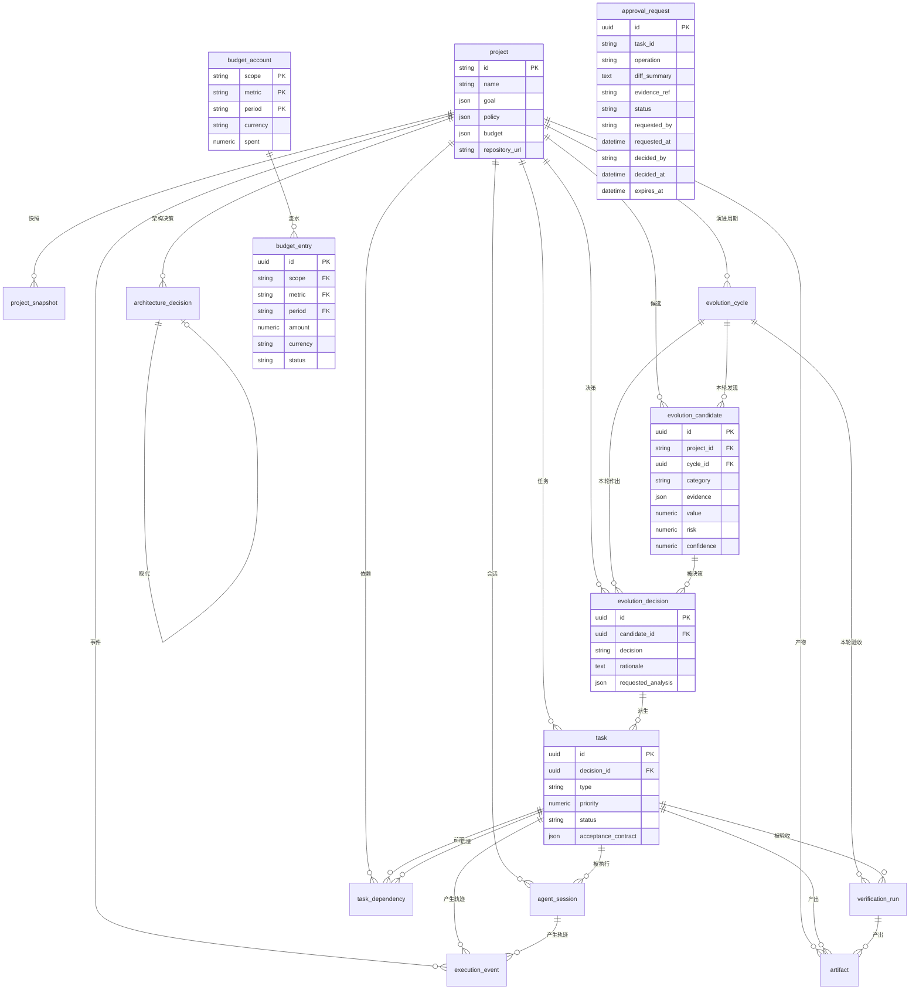

# 数据模型 —— 十二个核心实体 + 预算账本 + 审批请求

设计依据：`docs/design.md` §3.6（核心数据模型、四类存储职责分离）、
`docs/tasks.md` TASK-P1-020（schema 与迁移）、TASK-P1-022（三表分离约束）、
TASK-P1-024（证据 append-only）、TASK-P1-012（预算账本）。

这份文档是**从代码生成后手工整理**的，权威来源是 `core/entities/` 下的 ORM
模型与 `migrations/versions/` 下的迁移脚本。`tests/unit/database/test_data_model_doc.py`
会断言本文档与模型一致 —— 改了模型不改文档，测试会红。

## 0. 存储职责分离

design.md §3.6 要求四类存储各司其职。本数据模型只覆盖其中第二类：

| 存储 | 存什么 | 本阶段覆盖 |
| --- | --- | --- |
| Git | 项目的真实工程资产 | 否（由 Agent 在沙箱内操作） |
| PostgreSQL | 项目的结构化状态 | **是 —— 本文档范围** |
| 语义检索 | 知识发现 | 否（阶段二） |
| 对象存储 | 不可丢失的执行产物 | 只存元数据（`artifact.uri` + `artifact.hash`），内容在 MinIO/S3 |

不要把 Agent 的对话历史当作项目事实：`execution_event` 存的是**执行轨迹**
（谁、什么时候、做了什么、载荷是什么），不是知识来源。

## 1. 实体总览

十二个核心实体，四组归属；外加两张**预算账本**表（第五组）与一张**审批请求**
表（第六组）：

| 组 | 实体 | 表名 | 作用 |
| --- | --- | --- | --- |
| 项目 | `Project` | `project` | 项目定义（目标 / 策略 / 预算 / 仓库） |
| 项目 | `ProjectSnapshot` | `project_snapshot` | 某一时点的项目状态（version + commit + metrics） |
| 演进 | `EvolutionCycle` | `evolution_cycle` | 一轮演进周期（触发源 / 结果 / 指标） |
| 演进 | `EvolutionCandidate` | `evolution_candidate` | 发现的机会（证据 / 价值 / 风险） |
| 演进 | `EvolutionDecision` | `evolution_decision` | 对机会作出的决策（决策 / 理由） |
| 执行 | `Task` | `task` | 研发任务（类型 / 优先级 / 状态） |
| 执行 | `TaskDependency` | `task_dependency` | 任务间的先后依赖 |
| 执行 | `AgentSession` | `agent_session` | 一次执行会话（执行器 / 会话 ID / 授权快照） |
| 执行 | `ExecutionEvent` | `execution_event` | 执行轨迹（事件类型 / 载荷） |
| 证据 | `VerificationRun` | `verification_run` | 验收记录（检查项 / 结果） |
| 证据 | `Artifact` | `artifact` | 交付证据（URI / hash / 类型） |
| 知识 | `ArchitectureDecision` | `architecture_decision` | 架构决策（背景 / 决策 / 取舍） |
| 预算 | `BudgetAccount` | `budget_account` | 预算累计额（归属 / 维度 / 周期 → 已花） |
| 预算 | `BudgetEntry` | `budget_entry` | 预算流水（append-only，每次扣减一条） |
| 审批 | `ApprovalRequest` | `approval_request` | 人工审批请求（谁在什么时候批了什么） |

> **预算那两张表不在 `docs/design.md` §3.6 的清单里** —— 那是设计文档的一处缺口，
> 已在 `docs/tasks.md` 第 6 节列为待裁决项 8。补它们的理由很直接：TASK-P1-012
> 要求"用真实并发写库验证"，而十二个实体里没有任何一张表能承载预算累计额。

> **审批那张表也不在 §3.6 的清单里** —— 但 §7 的初始自主权限里写着"代码合并 =
> L2 需要人工审批"。人工审批必须落到某张表上，否则那条权限只是一句文档：编排器
> 等审批、API 让人批、CLI 让人批，三者看到的必须是**同一条记录**。补它的理由与
> 预算那两张一样具体 —— 没有这张表，"等审批"就只能是编排器内存里的一个布尔值。

> `core.entities.Project`（ORM 实体）与 `core.project.models.Project`（纯领域模型）
> 是两个同名但不同层的对象。前者负责落库，后者负责校验。两者之间用
> `to_domain()` / `from_domain()` 转换。

## 2. 关系图

### 2.1 文本版（精确，可当查询用）

| 子表 | 列 | 父表 | 父列 | ondelete |
| --- | --- | --- | --- | --- |
| `architecture_decision` | `project_id` | `project` | `id` | RESTRICT |
| `architecture_decision` | `supersedes_id` | `architecture_decision` | `id` | RESTRICT |
| `evolution_cycle` | `project_id` | `project` | `id` | RESTRICT |
| `project_snapshot` | `project_id` | `project` | `id` | RESTRICT |
| `evolution_candidate` | `project_id` | `project` | `id` | RESTRICT |
| `evolution_candidate` | `cycle_id` | `evolution_cycle` | `id` | RESTRICT |
| `evolution_decision` | `project_id` | `project` | `id` | RESTRICT |
| `evolution_decision` | `candidate_id` | `evolution_candidate` | `id` | RESTRICT |
| `evolution_decision` | `cycle_id` | `evolution_cycle` | `id` | RESTRICT |
| `task` | `project_id` | `project` | `id` | RESTRICT |
| **`task`** | **`decision_id`** | **`evolution_decision`** | **`id`** | **RESTRICT** |
| `agent_session` | `project_id` | `project` | `id` | RESTRICT |
| `agent_session` | `task_id` | `task` | `id` | RESTRICT |
| `task_dependency` | `project_id` | `project` | `id` | RESTRICT |
| `task_dependency` | `predecessor_id` | `task` | `id` | RESTRICT |
| `task_dependency` | `successor_id` | `task` | `id` | RESTRICT |
| `verification_run` | `task_id` | `task` | `id` | RESTRICT |
| `verification_run` | `cycle_id` | `evolution_cycle` | `id` | RESTRICT |
| `artifact` | `project_id` | `project` | `id` | RESTRICT |
| `artifact` | `task_id` | `task` | `id` | RESTRICT |
| `artifact` | `verification_run_id` | `verification_run` | `id` | RESTRICT |
| `execution_event` | `project_id` | `project` | `id` | RESTRICT |
| `execution_event` | `task_id` | `task` | `id` | RESTRICT |
| `execution_event` | `session_id` | `agent_session` | `id` | CASCADE |
| `budget_entry` | `scope` | `budget_account` | `scope` | RESTRICT |
| `budget_entry` | `metric` | `budget_account` | `metric` | RESTRICT |
| `budget_entry` | `period` | `budget_account` | `period` | RESTRICT |

**唯一的 CASCADE** 是 `execution_event.session_id → agent_session.id`：
会话是一次性的尝试，它的轨迹随会话一起消失是合理的。其余全部 RESTRICT ——
删项目之前必须先想清楚，历史证据、决策链、任务链都不该被级联抹掉。

`budget_entry → budget_account` 是**三列联合外键**（`scope` + `metric` + `period`）。
拆成三行写是因为本表一列一行；实际在库里是一个 `ForeignKeyConstraint`，
指向联合主键 `(scope, metric, period)`。

**`approval_request` 不在上表里，因为它是唯一一张没有外键的业务表。**
这不是漏了 —— 是刻意的：审批请求可以在任务还没落库时被发起（策略检查发生在
编排早期），一条悬空引用不该让整张表写不进去。代价是"这条审批属于哪个任务"
只能靠应用层保证；补偿手段是 `task_id` 上建了索引，查询照常快。

这一点与三表分离并不冲突：三表分离管的是"任务从哪来"（决策 → 任务），
审批管的是"这次操作能不能做" —— 审批是**放行的条件**，不是任务的**来源**。
把审批挂成任务的外键，等于说"没有任务的审批不合法"，而策略检查恰恰发生在
任务落库之前。

### 2.2 图版



## 3. 三表分离（本文档最关键的一节）

design.md §3.6 的核心主张：**「发现问题」「作出决策」「执行任务」必须是三件不同的事**。

```
EvolutionCandidate ──1:N──> EvolutionDecision ──1:N──> Task
        发现                    决策                    执行
```

这条链上的每一跳都是数据库层面的硬约束，不是应用层的"请记得检查"：

| 约束 | 定义 | 挡住什么 |
| --- | --- | --- |
| `fk_task_decision_id_evolution_decision` | `task.decision_id NOT NULL` | 没有决策来源的任务 —— 即"Agent 发现问题后直接改代码" |
| `fk_evolution_decision_candidate_id_evolution_candidate` | `evolution_decision.candidate_id NOT NULL` | 没有证据来源的决策 |
| `evolution_decision.decision_state` | `decision IN ('record','defer','reject')` | 第四种决策态 |
| `evolution_decision.defer_requires_analysis` | `defer` 必须带非空 `requested_analysis` | "以后再说"但没说清还要补什么 |
| 仓储层唯一入口 | `TaskRepository.create_from_decision` | 绕过决策链的应用层写入 |

三者缺一不可：

1. **数据库约束**保证"绕过应用层写 SQL"也进不来。
2. **仓储层检查**保证错误信息可读（"决策是 defer，只有 record 能派生任务"，
   而不是甩一个 `ForeignKeyViolation`）。
3. **静态检查**（`tests/unit/database/test_bypass_paths.py`）保证代码库里
   不存在第二个构造 `Task` 的地方 —— 靠人记住"只有这里能建任务"迟早会漏。

### 3.1 defer 与 reject 不得产生任务

R-034 / R-035：`defer`（先补分析再定）与 `reject`（放弃）是**合法的"不行动"结局**。
它们各自落成一条 `EvolutionDecision` 记录 —— 放弃也要留痕，理由写在 `rationale` 里 ——
但**该轮不得创建 Task**。

数据库层面无法直接表达"这条决策不派生任务"（因为任务是从决策派生的，不是从决策
禁止派生的）。所以由仓储层把关：`create_from_decision` 在决策不是 `record` 时抛
`NonExecutableDecisionError`。

### 3.2 验收契约是准入闸门（R-051）

`ck_task_acceptance_contract_required`：

```sql
status NOT IN ('RUNNING','VERIFYING','PASSED','REPAIRING','INTEGRATING','MERGED','COMPLETED')
OR acceptance_contract IS NOT NULL
```

任务一旦进入执行态，验收契约必须已经存在并绑定本任务。这条约束在数据库层，
所以任何绕过状态机的 SQL 写入同样会被拒绝 —— 验收契约是**准入闸门**，
不是事后补写的报告。

Python 侧的状态机（`core/task/state_machine.py`）是 14 态的唯一真相来源；
`task.status` 的 CHECK 约束**由该枚举生成**（`core/entities/task.py` 的
`_TASK_STATE_VALUES`），加一个状态，约束自动跟着变，两边不会漂移。

## 4. 证据的 append-only（R-099 / TASK-P1-024）

`verification_run` 与 `artifact` 只允许 INSERT。数据库上挂了两个触发器
（`migrations/versions/0001_initial_schema.py` 的 `ases_append_only_guard()`）：

| 触发器 | 时机 | 拒绝什么 |
| --- | --- | --- |
| `trg_<表>_append_only_update_delete` | BEFORE UPDATE OR DELETE FOR EACH ROW | 改写、删除已记录的证据 |
| `trg_<表>_append_only_truncate` | BEFORE TRUNCATE FOR EACH STATEMENT | 整表清空 |

理由：已完成的验收证据不能因为下一轮演进而丢失。触发器而不是应用层检查，
是因为"清空历史"这种操作最常见的路径恰恰是应用层之外 —— 运维脚本、
`psql` 手敲、误配的定时任务。`ERRCODE` 用 `restrict_violation` 而不是默认的
`raise_exception`，语义上更准确：这是"违反限制"，不是"内部错误"。

产物内容本身在对象存储里，以 `sha256` 寻址（key = `sha256:<hex>`）。
`artifact.hash` 存的是内容摘要，CHECK 约束 `char_length(hash) = 64`。
校验在**读取时**做，不是写入时 —— 写入时校验只能证明"写进去的是对的"，
读时校验才能证明"现在拿到的还是对的"。

### 4.1 预算账本：累计额只增不减（TASK-P1-012）

预算账本有两道**数据库层的拒绝**（`migrations/versions/0003_budget_ledger.py`）：

| 触发器 | 表 | 拒绝什么 |
| --- | --- | --- |
| `trg_budget_account_monotonic` | `budget_account` | 把 `spent` 改小的 UPDATE |
| `trg_budget_account_append_only_delete` | `budget_account` | DELETE |
| `trg_budget_account_append_only_truncate` | `budget_account` | TRUNCATE |
| `trg_budget_entry_append_only_update_delete` | `budget_entry` | UPDATE / DELETE |
| `trg_budget_entry_append_only_truncate` | `budget_entry` | TRUNCATE |

第一条与 append-only 不同：它拦的不是"改内容"，是"**改小**"。预算是防超支的
闸门，而闸门最怕的就是有人能把计数器调回去 —— 允许改小就等于允许清零，
"总额不超限"这条不变量立刻失效。

并发正确性不靠这一层，靠的是应用层的行级锁（`SELECT … FOR UPDATE`，
见 `infrastructure/database/budget.py`）：在 PostgreSQL 的 READ COMMITTED 下，
拿到锁之后会重新读取该行的最新已提交版本，于是"查余额"与"扣减"之间没有缝隙。
数据库触发器负责的是"绕过应用层也改不动"，两件事分开做。

## 5. 身份：Agent 身份 ≠ 任务身份（R-063）

`agent_session` 同时存 `agent_id` 和 `task_id`，并且把**授权快照**写进
`authorization` 字段（`agent_id` / `task_id` / `project_id` / `workspace_id` /
`expiry`）。

为什么要存快照而不是只存 ID：事后审计要能回答"**当时授权的是什么**"，
而不是"当时应该授权什么"。规则后来改了，历史记录不能跟着改 —— 那正是
`agent_session` 不可变的原因之一。

`authorization` 的五个要素就是授权判定的 key：有仓库读权限的 Agent，
仍然不能在任务 A 里执行任务 B 的合并。判定的落地点是 TASK-P1-044。

## 6. 字段明细

以下字段类型取自 SQLAlchemy 元数据。`JSON` 列在 PostgreSQL 上实际是 `JSONB`
（`core/entities/base.py` 的 `JSONDocument` 做了方言适配）—— JSONB 可建索引。

### 6.1 `project`

| 列 | 类型 | 约束 | 说明 |
| --- | --- | --- | --- |
| `id` | VARCHAR(64) | PK | 业务可读的项目标识（不是 UUID） |
| `name` | VARCHAR(255) | NOT NULL | |
| `goal` | JSONB | NOT NULL | 六要素目标模型（TASK-P1-010） |
| `policy` | JSONB | NOT NULL | 自治策略快照 |
| `budget` | JSONB | NOT NULL | 预算快照 |
| `repository_url` | VARCHAR(1024) | NOT NULL | |
| `default_branch` | VARCHAR(255) | NOT NULL | |
| `tech_stack` | JSONB | NOT NULL | |
| `environment` | JSONB | NOT NULL | 环境配置（迁移 `0002` 补上） |
| `created_at` / `updated_at` | TIMESTAMPTZ | NOT NULL | |

### 6.2 `project_snapshot`

| 列 | 类型 | 约束 | 说明 |
| --- | --- | --- | --- |
| `id` | UUID | PK | |
| `project_id` | VARCHAR(64) | FK → project, NOT NULL | |
| `version` | INTEGER | NOT NULL | 与 `project_id` 组成唯一键 |
| `commit` | VARCHAR(64) | NOT NULL | commit SHA |
| `branch` | VARCHAR(255) | | |
| `metrics` | JSONB | NOT NULL | **落盘**的指标，不实时查 —— 使快照可事后重建 |

索引：`uq_project_snapshot_project_id_version`（唯一）、`ix_project_snapshot_project_id_commit`。

### 6.3 `evolution_cycle`

| 列 | 类型 | 约束 | 说明 |
| --- | --- | --- | --- |
| `id` | UUID | PK | |
| `project_id` | VARCHAR(64) | FK → project, NOT NULL | |
| `cycle_id` | VARCHAR(64) | NOT NULL, UNIQUE | 周期编号 |
| `trigger` | VARCHAR(64) | NOT NULL | 六种触发源之一 |
| `status` | VARCHAR(32) | CHECK | 周期**怎么**结束：completed / aborted / budget_exhausted / blocked。空 = 还没结束 |
| `outcome` | VARCHAR(64) | CHECK | 这一轮**有没有变好**：improved / no_change / regressed / stalled。空 = 还没结束 |
| `metrics` | JSONB | NOT NULL | 计数 / 达成度快照 / 成本 / 证据引用 |
| `started_at` / `ended_at` | TIMESTAMPTZ | | |

索引：`ix_evolution_cycle_project_id_started_at`。

约束：`ck_evolution_cycle_evolution_cycle_status_values`、
`ck_evolution_cycle_evolution_cycle_outcome_values`。

**为什么"怎么结束"和"有没有变好"是两个字段。** 两件事都叫"结局"，但它们是
两个维度：一轮被预算掐断的周期，`status` 是 `budget_exhausted`，`outcome` 是
`stalled` —— 跑完了（虽然是掐断的），但没变好。合成一个字段，就必然丢掉其中
一个。详见 `core/metrics/cycle.py`。

### 6.4 `evolution_candidate`

| 列 | 类型 | 约束 | 说明 |
| --- | --- | --- | --- |
| `id` | UUID | PK | |
| `project_id` | VARCHAR(64) | FK → project, NOT NULL | |
| `cycle_id` | UUID | FK → evolution_cycle | 哪一轮发现的 |
| `category` | VARCHAR(32) | NOT NULL | product / architecture / engineering / quality / technology |
| `title` | VARCHAR(512) | NOT NULL | |
| `evidence` | JSONB | NOT NULL | 结构化证据引用。**候选存在的唯一理由** |
| `hypothesis` | TEXT | | 假设：做了会怎样 |
| `expected_outcome` | JSONB | NOT NULL | |
| `value` | NUMERIC(12,4) | NOT NULL, CHECK 0~1 | 预期价值 V |
| `risk` | NUMERIC(12,4) | NOT NULL, CHECK 0~1 | 风险系数 R |
| `confidence` | NUMERIC(12,4) | NOT NULL, CHECK 0~1 | 证据置信度 C |
| `estimated_effort` | VARCHAR(64) | | 如 `"2d"`。保持字符串 —— 成本单位不统一是常态 |
| `status` | VARCHAR(32) | NOT NULL | proposed / accepted / rejected / deferred |

索引：`ix_evolution_candidate_project_id_status`。

### 6.5 `evolution_decision`

| 列 | 类型 | 约束 | 说明 |
| --- | --- | --- | --- |
| `id` | UUID | PK | |
| `candidate_id` | UUID | FK → evolution_candidate, NOT NULL | **三表分离第二跳** |
| `project_id` | VARCHAR(64) | FK → project, NOT NULL | 冗余，便于按项目查决策 |
| `cycle_id` | UUID | FK → evolution_cycle | |
| `decision` | VARCHAR(32) | NOT NULL, CHECK 三态 | `record` / `defer` / `reject` |
| `rationale` | TEXT | NOT NULL | 决策理由。放弃也要说清楚为什么 |
| `requested_analysis` | JSONB | NOT NULL | `defer` 时必须非空（CHECK） |
| `overridden_by` | VARCHAR(64) | | 人工覆盖时记录覆盖者 |

索引：`ix_evolution_decision_project_id_created_at`。

### 6.6 `task`

| 列 | 类型 | 约束 | 说明 |
| --- | --- | --- | --- |
| `id` | UUID | PK | |
| `project_id` | VARCHAR(64) | FK → project, NOT NULL | |
| `decision_id` | UUID | FK → evolution_decision, NOT NULL | **三表分离第三跳** |
| `title` | VARCHAR(512) | NOT NULL | |
| `description` | TEXT | | |
| `type` | VARCHAR(64) | NOT NULL | 自由字符串 —— 任务种类随项目而变 |
| `priority` | NUMERIC(12,4) | NOT NULL | Director 评分模型产出 |
| `status` | VARCHAR(32) | NOT NULL, CHECK 14 态 | 状态机唯一真相来源在 Python 侧 |
| `acceptance_contract` | JSONB | CHECK | 进入执行态前必须非空（R-051） |
| `branch` | VARCHAR(255) | | 集成分支名 |
| `workspace_id` | VARCHAR(64) | | 授权判定五要素之一 |
| `executor` | VARCHAR(64) | | 计划使用的执行器 |
| `repair_count` | INTEGER | NOT NULL, CHECK ≥ 0 | 修复闸门计数 |
| `started_at` / `completed_at` | TIMESTAMPTZ | | |
| `extra` | JSONB | NOT NULL | |

索引：`ix_task_project_id_status`、`ix_task_decision_id`。

### 6.7 `task_dependency`

| 列 | 类型 | 约束 | 说明 |
| --- | --- | --- | --- |
| `id` | UUID | PK | |
| `project_id` | VARCHAR(64) | FK → project, NOT NULL | |
| `predecessor_id` | UUID | FK → task, NOT NULL | |
| `successor_id` | UUID | FK → task, NOT NULL | |
| `dependency_type` | VARCHAR(32) | NOT NULL | 默认 `finish_to_start` |
| `created_at` | TIMESTAMPTZ | NOT NULL | |

约束：`uq_task_dependency_edge`（同一对只能有一条边）、`ck_task_dependency_no_self_dependency`
（自己依赖自己是死锁，不是依赖）。

### 6.8 `agent_session`

| 列 | 类型 | 约束 | 说明 |
| --- | --- | --- | --- |
| `id` | UUID | PK | |
| `project_id` | VARCHAR(64) | FK → project, NOT NULL | |
| `task_id` | UUID | FK → task, NOT NULL | **任务身份** —— 与 agent_id 分开 |
| `agent_id` | VARCHAR(128) | NOT NULL | **Agent 身份** |
| `executor` | VARCHAR(64) | NOT NULL | 执行器种类 |
| `session_id` | VARCHAR(255) | NOT NULL | 执行器侧的会话标识 |
| `authorization` | JSONB | NOT NULL | 授权快照（五要素） |
| `status` | VARCHAR(32) | NOT NULL | |
| `started_at` | TIMESTAMPTZ | NOT NULL | |
| `ended_at` | TIMESTAMPTZ | | |
| `extra` | JSONB | NOT NULL | |

索引：`ix_agent_session_task_id_agent_id`、`ix_agent_session_project_id_created_at`。

### 6.9 `execution_event`

| 列 | 类型 | 约束 | 说明 |
| --- | --- | --- | --- |
| `id` | UUID | PK | |
| `session_id` | UUID | FK → agent_session, ON DELETE CASCADE | |
| `task_id` | UUID | FK → task | |
| `project_id` | VARCHAR(64) | FK → project | |
| `agent_id` | VARCHAR(128) | | |
| `event_type` | VARCHAR(64) | NOT NULL | |
| `payload` | JSONB | NOT NULL | |
| `causation_id` | VARCHAR(64) | | 因果链：谁引起了我 |
| `correlation_id` | VARCHAR(64) | | 相关链：同一件事的一串事件 |
| `sequence` | INTEGER | | 会话内序号 |
| `size_bytes` | BIGINT | | 载荷大小，便于裁剪与计费 |
| `created_at` | TIMESTAMPTZ | NOT NULL | |

索引：`ix_execution_event_task_id_created_at`、`ix_execution_event_session_id_sequence`、
`ix_execution_event_causation_id`、`ix_execution_event_correlation_id`。

### 6.10 `verification_run`

| 列 | 类型 | 约束 | 说明 |
| --- | --- | --- | --- |
| `id` | UUID | PK | |
| `task_id` | UUID | FK → task, NOT NULL | |
| `cycle_id` | UUID | FK → evolution_cycle | 哪一轮的验收 |
| `checks` | JSONB | NOT NULL, CHECK 非空数组 | 检查项与结果 |
| `result` | VARCHAR(32) | NOT NULL, CHECK 四态 | passed / failed / error / skipped |
| `verified_by` | VARCHAR(128) | NOT NULL | **独立验证器**，不是执行者自评 |
| `duration_ms` | INTEGER | | |
| `created_at` | TIMESTAMPTZ | NOT NULL | |

**append-only。** 索引：`ix_verification_run_task_id_created_at`。

### 6.11 `artifact`

| 列 | 类型 | 约束 | 说明 |
| --- | --- | --- | --- |
| `id` | UUID | PK | |
| `task_id` | UUID | FK → task | |
| `verification_run_id` | UUID | FK → verification_run | |
| `project_id` | VARCHAR(64) | FK → project | |
| `uri` | VARCHAR(1024) | NOT NULL | 对象存储地址 |
| `hash` | VARCHAR(64) | NOT NULL, CHECK 长度 64 | sha256 十六进制 |
| `type` | VARCHAR(64) | NOT NULL | |
| `size_bytes` | BIGINT | | |
| `retention_until` | TIMESTAMPTZ | | 保留期 |

**append-only。** 索引：`ix_artifact_hash`、`ix_artifact_task_id_created_at`。

### 6.12 `architecture_decision`

| 列 | 类型 | 约束 | 说明 |
| --- | --- | --- | --- |
| `id` | UUID | PK | |
| `project_id` | VARCHAR(64) | FK → project, NOT NULL | |
| `context` | TEXT | NOT NULL | 背景 |
| `decision` | TEXT | NOT NULL | 决策 |
| `tradeoff` | TEXT | | 取舍 —— 没写取舍的架构决策等于没做决策 |
| `status` | VARCHAR(32) | NOT NULL | proposed / accepted / superseded / rejected |
| `supersedes_id` | UUID | FK → architecture_decision | 取代哪一条 |
| `extra` | JSONB | NOT NULL | |

索引：`ix_architecture_decision_project_id_created_at`。

### 6.13 `budget_account`

| 列 | 类型 | 约束 | 说明 |
| --- | --- | --- | --- |
| `scope` | VARCHAR(64) | PK 之一 | 预算归属。阶段一固定值，阶段四取 project id |
| `metric` | VARCHAR(32) | PK 之一 | 计量维度：`daily_cost` / `token_usage` / … |
| `period` | VARCHAR(32) | PK 之一 | 周期键。`day:2026-11-06` 或 `lifetime` |
| `currency` | VARCHAR(16) | NOT NULL | 币种。累计额的单位，不能混算 |
| `spent` | NUMERIC(20,6) | NOT NULL | 已消耗额。**只增不减**（触发器强制） |
| `created_at` / `updated_at` | TIMESTAMPTZ | NOT NULL | |

联合主键 `(scope, metric, period)`。周期是主键的一部分，所以**日切不需要删除
任何行** —— 新的一天是一行新的累计额，累计额自然从零开始。这对 append-only
的账本是硬要求：账本不允许删除，日切就不能靠删除实现。

索引：`ix_budget_account_scope_metric`。

### 6.14 `budget_entry`

| 列 | 类型 | 约束 | 说明 |
| --- | --- | --- | --- |
| `id` | UUID | PK | |
| `scope` | VARCHAR(64) | FK → budget_account | 三列联合外键 |
| `metric` | VARCHAR(32) | FK → budget_account | |
| `period` | VARCHAR(32) | FK → budget_account | |
| `amount` | NUMERIC(20,6) | NOT NULL | 本次扣减额 |
| `currency` | VARCHAR(16) | NOT NULL | |
| `status` | VARCHAR(16) | NOT NULL | `recorded`（真扣了）/ `blocked`（超限被拒） |
| `recorded_at` | TIMESTAMPTZ | NOT NULL | |

**append-only。** 索引：`ix_budget_entry_scope_metric_recorded_at`。

被拒绝的扣减尝试也留痕（`status = 'blocked'`）—— "系统试图超预算但被拦住了"
本身就是需要被看见的事实，尤其是当它反复发生时。

### 6.15 `approval_request`

| 列 | 类型 | 约束 | 说明 |
| --- | --- | --- | --- |
| `id` | UUID | PK | 与领域层 `ApprovalRequest.request_id` 是同一个身份，不搞两套编号 |
| `task_id` | VARCHAR(64) | NOT NULL | 被审批的任务。**不建外键** —— 见 §2.1 |
| `operation` | VARCHAR(64) | NOT NULL | 被审批的操作。取值来自 `core.policy.autonomy.Operation` |
| `diff_summary` | TEXT | NOT NULL | 人批的是他看到的那份改动 |
| `evidence_ref` | VARCHAR(1024) | NOT NULL | 验证证据引用（验证记录或产物 URI） |
| `status` | VARCHAR(32) | NOT NULL, CHECK 五态 | pending / approved / rejected / expired / withdrawn |
| `requested_by` | VARCHAR(128) | NOT NULL | 请求人 |
| `requested_at` | TIMESTAMPTZ | NOT NULL | 发起时刻 |
| `decided_by` | VARCHAR(128) | | 审批人。还没有结论时为空 |
| `decided_at` | TIMESTAMPTZ | | 表态时刻 |
| `expires_at` | TIMESTAMPTZ | | 有效期。**过期后不可用于放行**（I-12） |
| `comment` | TEXT | NOT NULL | 审批意见 / 撤回理由 |
| `created_at` / `updated_at` | TIMESTAMPTZ | NOT NULL | |

索引：`ix_approval_request_task_operation`（按任务 + 操作查最新一条）、
`ix_approval_request_status`（审批列表按状态筛）。

约束：`ck_approval_request_approval_status_values` —— 状态取值由
`core.policy.approval.ApprovalStatus` 枚举生成，枚举加状态，约束自动跟着变。

**这张表记的是"人做了什么"，不是"现在能不能做"。** 两个问题的答案落在不同的
地方：表里有 `requested_by` / `decided_by` / `requested_at` / `decided_at`，记的是
谁在什么时候对什么做出了什么动作；而"现在能不能放行"是**算出来的**结论
（`core/policy/approval.py` 拿 `expires_at` 与当前时刻比）。把后者也存成一列，
就会出现"表里写着 approved、系统却拒绝放行"这种两边都觉得自己对的状态。

**过期是终态，不是"还没批"。** 人批的是"当时那一份 diff" —— diff 变了、代码变了，
那份批准就不再成立。所以过期的记录不能放行，哪怕它当时是 approved；反过来，
**拒绝是粘的** —— 拒绝过的记录不会因为过期而变成"没人反对"。这两条次序规则
写在 `ApprovalRequest.outcome()` 里，并有定点变异测试盯着。

**一条请求只能被表态一次**，且这件事在并发下也成立。实现上用
`SELECT … FOR UPDATE` 锁住那一行：两个人同时点"批准"和"拒绝"，后到的那次
必须失败，而不是覆盖掉先到的结论 —— 同一个请求有两个互相矛盾的结论，
"哪个算数"这个问题没有好答案。

**状态不是自由文本。** CHECK 约束是最后一道防线：脚本、手工 SQL 直插也要过它。
否则"这条审批到底处于什么状态"这个问题就没有唯一答案。

## 7. 命名的三条约定

1. **表名复数、单数混乱** —— 一律单数下划线（`evolution_candidate`）。
   PostgreSQL 里表名不带 `pg_` 前缀的系统表，方便升级。
2. **主键** —— 除 `project` 用业务可读的 `VARCHAR(64)` 外，其余全部 UUID。
   UUID 不泄漏业务量，也不暗示插入顺序 —— 从 ID 里猜出"这个项目做了多少任务"
   本身就是一种信息泄漏。
3. **约束必须具名** —— `NAMING_CONVENTION` 让 Alembic 的 downgrade 有确定目标。
   没有名字，回滚就只能靠顺序碰运气。命名约定里 `ck` 用
   `%(constraint_name)s`，因此**所有 CHECK 约束都必须显式给 name**，
   漏命名会在建表时当场报错 —— 这正是我们要的。

## 8. 迁移

| 修订 | 内容 |
| --- | --- |
| `0001` | 十二张表 + 三表分离约束 + 验收契约 CHECK + 决策三态 CHECK + append-only 触发器 |
| `0002` | `project.environment` 列（JSONB）—— 领域模型有、库里缺 |
| `0003` | 预算账本两表 + 累计额单调守卫 + 预算流水 append-only 触发器 |
| `0004` | `evolution_cycle` 一分为二：`status`（怎么结束）+ `outcome`（有没有变好） |
| `0005` | 审批请求表 + 状态 CHECK 约束 + 查询索引 |

迁移工具链的验证见 `tests/integration/test_migrations.py`：
`upgrade head` → `downgrade base` → `upgrade head` 可逆；空库从零迁移 < 30s；
重复执行 `upgrade head` 幂等。

连接串只从配置注入：`alembic.ini` 里的 `sqlalchemy.url` 保持为空，
`migrations/env.py` 从 `get_settings().database_url` 取值。
版本库里不出现任何凭证。

## 9. 相关文档

- `docs/design.md` —— 系统总设计
- `docs/tasks.md` —— 任务清单（本模型的验收标准在 TASK-P1-020 / 022 / 024 / 012）
- `core/entities/` —— ORM 模型（本文档的权威来源）
- `migrations/versions/` —— 迁移脚本
- `core/task/state_machine.py` —— 14 态状态机
- `core/policy/budget.py` —— 预算领域逻辑与账本端口
- `infrastructure/database/budget.py` —— 数据库预算账本（行级锁）
- `core/policy/approval.py` —— 审批领域模型（结论怎么算、过期怎么算）
- `infrastructure/database/approval.py` —— 数据库审批存储（`FOR UPDATE` 独占表态）
