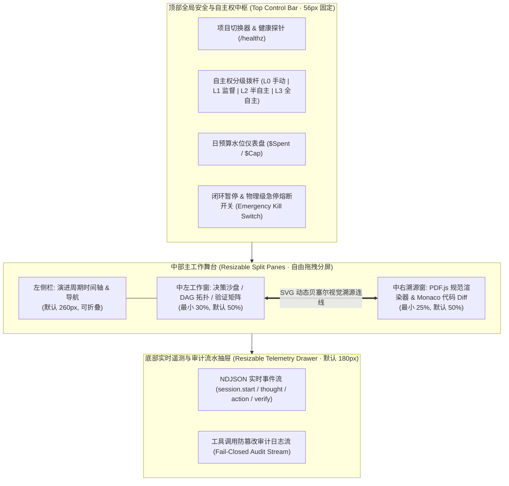

# ASES 前端架构与交互设计（ASES Cockpit · 自主演进控制舱）

设计依据：
- `docs/design.md` §1.2 态势感知与自主权分级控制、§3.2 任务拆解与 DAG 依赖图、§3.4 多执行器监控与实时事件流、§3.5B 独立六层验证结果矩阵、§7 治理审批门与防篡改审计、§8 工程目录结构（`apps/dashboard/`）；
- `docs/architecture/trend-board.md` 跨周期趋势看板（四层指标曲线、诚实缺失态、R-117 虚荣指标结构性拒绝）；
- `docs/architecture/high-risk-review.md` 高风险变更治理（操作 × 种类双轴风险、名册资格核验、SHA-256 内容指纹锁定）；
- `apps/api/control.py` 控制面 REST API 与内嵌单页控制台（`/ui`）。

---

## 一、 设计理念与核心不变量的前端映射

ASES 前端不是传统的「聊天对话框」或「CI 任务列表」，而是人类指挥官对 AI 研发组织进行**目标设定、态势感知、证据溯源、决策干预与高风险审批**的控制舱。

| 系统核心不变量 / 架构约束 | 前端视觉与交互映射 | 关联后端实现 |
| :--- | :--- | :--- |
| **1. 双环严格解耦**（循环 B 宏观演进 ≠ 循环 A 微观执行） | 主工作台按「宏观认知与决策沙盘（Loop B）」与「微观 DAG 调度与六层验证（Loop A）」分区呈现，严禁混成单一聊天流 | `apps/director/m2_cycle.py` |
| **2. 候选 ≠ 决策 ≠ 任务**（三表外键分离） | 采用三阶漏斗视图：`EvolutionCandidate`（机会卡片）$\rightarrow$ `EvolutionDecision`（Critic 质询与沙盘裁决）$\rightarrow$ `Task`（DAG 节点） | `core/entities/evolution.py`、`core/entities/task.py` |
| **3. 验证独立于执行**（`self_assessment` 不参与判定） | 将 Agent 的自我报告折叠为灰色次要参考，主视觉突出展示独立进程的**六层验证矩阵** | `core/task/outcome.py`、`harness/verification/engine.py` |
| **4. 算不出来 ≠ 0 & 拒绝虚荣指标** | 趋势看板在前端层面**结构性拒绝**渲染任务数、Token 数、提交量；对 `no_samples` 和 `baseline_missing` 渲染专用 `—` 缺失态徽标与原因说明，绝不渲染为 `0%` | `docs/architecture/trend-board.md`、`evaluation/trend.py` |
| **5. 高风险双轴治理与防篡改签名** | 审批台强制展示 `content_digest`（SHA-256）指纹锁与名册资格（`architecture` / `security` / `governance`），内容发生 1 字节变动即置灰失效 | `docs/architecture/high-risk-review.md`、`core/policy/high_risk.py` |

---

## 二、 整体布局与可拖拽分屏架构（Resizable Split Panes）

控制舱采用全视口无页面级滚动（`100vh × 100vw, overflow-hidden`）的 **四区可拖拽分屏架构**，基于 `react-resizable-panels`（或原生拖拽分割条）实现面板比例自由伸缩与布局持久化：



---

## 三、 六大核心 UX 优化机制详细设计

### 1. 高保真文档与证据渲染（PDF.js + Monaco Dual Viewer）
在右侧「证据与源码溯源窗」内置双模渲染引擎：
- **PDF.js 高保真文档渲染器**：针对项目 PRD、架构规范 PDF、安全扫描报告 PDF（存储在 MinIO `Artifact` 库中），通过 `pdfjs-dist` 实现 Canvas + TextLayer 双层渲染，支持页码跳转、关键词高亮、缩放自适应及矩形坐标框（Bounding Box）标注。
- **Monaco Diff / AST 源码查看器**：针对代码级证据（如 `src/tinylib/cli.py:61`）和 Worktree 变更 Diff，提供语法高亮、行内批注与变更前后并排对比。

### 2. 可拖拽分屏面板（Resizable Split Panes）
- **三向可调分割条（Split Gutter）**：左栏与中栏、中左决策区与中右文档/代码区、主舞台与底部遥测抽屉之间均配置 `4px` 感应拖拽条（悬停高亮为 `brand-500` 蓝色，支持双击复位 50:50 比例）。
- **焦点最大化快捷键**：支持按 `Cmd/Ctrl + \` 快速收起左侧周期栏与底部遥测抽屉，将「验证矩阵 vs. PDF/代码溯源」扩展为全屏双栏审查模式。

### 3. 视觉溯源连线（Visual Traceability Overlay）
消除「AI 结论」与「原始事实证据」之间的认知断层：
- **跨面板 SVG 贝塞尔连线层**：在分屏容器顶层挂载一个 `pointer-events-none` 的全屏 `<svg id="traceability-overlay">`。
- **双向联动激活**：
  - 当用户在左侧点击或悬停某个演进候选（如 `CAND-001`）的证据条目 `evidence_ref`、或某项 Critic 质询结论时，右侧面板自动滚动至对应的 **PDF 规范段落 Bounding Box** 或 **源码行号**。
  - 同时，系统在左侧「结论锚点」与右侧「PDF 文本框 / 代码行锚点」之间绘制一条带脉冲动画的 SVG 三次贝塞尔曲线（绿色代表正证据支撑，红色代表冲突或失败断言）。

### 4. 置信度分级视觉系统（Confidence-Based Grading）
对系统提取的所有演进要素（`EvolutionCandidate`、`GoalGap`、优先级评分 $Priority = \frac{V \times I \times C \times U}{E \times (1+R)}$）实行严格的三级视觉编码：

| 置信度区间 ($C$) | 等级标签 | 视觉色彩规范（Tailwind） | 系统默认行为与 UI 标识 |
| :--- | :--- | :--- | :--- |
| $C \ge 0.80$ | **确凿级 (High / Verified)** | 翠绿 `emerald-400` / 边框 `emerald-700/50` | 附带复现单测或明确 AST 证据，默认推荐进入 `record` 立项通道 |
| $0.30 \le C < 0.80$ | **待核级 (Medium / Review)** | 琥珀 `amber-400` / 边框 `amber-600/50` | 存在局部证据但需人工校准假设或补充分析，高亮提示指挥官介入 |
| $C < 0.30$ | **投机级 (Low / Speculative)** | 绯红 `rose-400` / 边框 `rose-800/50`（半透明降噪） | 触发「不行动也是合法决策」保护机制，自动标记为 `deferred`（推迟） |

### 5. 提取结果行内编辑（Inline Editing for Extraction & Contracts）
AI 提取的演进机会或生成的验收契约往往需要人类架构师微调，而无需推翻重来：
- **双击即改（Click-to-Edit）**：在候选卡片与任务准入面板中，`title`（标题）、`hypothesis`（演进假设）、`expected_outcome`（预期收益）以及 `AcceptanceContract` 的阈值（如将覆盖率要求从 `>= 0.85` 改为 `>= 0.90`）均支持行内编辑。
- **修订留痕（Diff Pill & Audit）**：保存行内修改后，字段旁自动显示 `Edited by @reviewer` 徽标，Hover 可查看 AI 原始提取值与人工修改值的行内 Diff，并同步写入后端审计表。

### 6. 可执行风险工作流（Actionable Risk Workflows: Accept / Fix / Ignore）
每一处风险提示、演进候选、Critic 质询失败项或高风险审批卡片，均配备标准化的 **三态动作工作流按钮组**（告别只读报表）：
- **Accept（采纳 / 签名放行）**：
  - 在决策沙盘：确认候选立项（调用 `POST /api/v1/decisions/{decision_id}/override` 设为 `record`）。
  - 在高风险法庭：核验 SHA-256 指纹与名册资格后签署放行票据（调用 `POST /api/v1/governance/approvals/{request_id}/review`）。
- **Fix（行内修正 / 派发定向修复）**：
  - 在决策沙盘：打开行内编辑器微调变更边界或验收条件后再立项。
  - 在六层验证矩阵：针对某层未通过项（如架构越界或单测失败），一键生成定向修复任务（对接 `core/task/repair.py`），携带失败证据进入下一轮修复预算。
- **Ignore / Defer（忽略 / 推迟 / 驳回）**：
  - 将低置信度或非目标候选标记为 `defer`（暂缓）或 `reject`（永久忽略并加入反例库），防止下一轮周期重复发现（降低 `duplicate_discovery_rate`）。

---

## 四、 五大核心业务视图与交互设计

### 视图 1：双环态势与跨周期趋势看板（Dual-Loop & Trend Board）
- **顶部 4+2 指标卡与 7 天累计趋势图**：
  - 严格对齐 `docs/architecture/trend-board.md`，展示 **4 层 8 项核心指标**（自主发现层：有效发现率/重复发现率；决策质量层：采纳率/误报率；工程交付层：任务成功率/返工率/回归缺陷率；项目演进层：目标达成度差值 $\Delta$）+ **2 项诊断量**（验收通过率、累计花费）。
  - **诚实空值渲染**：当点状态为 `baseline_missing` 或 `no_samples` 时，图表节点渲染为空心虚线圆点，数值显示为 `—` 并附带 Tooltip 说明（如「尚未建立人工标注基线，算不出来 ≠ 0」）。
- **双环流转实时状态机**：左环展示循环 B 五阶段（认知 $\rightarrow$ 诊断 $\rightarrow$ 探索 $\rightarrow$ 决策 $\rightarrow$ 规划），右环展示循环 A 四步闭环，实时高亮当前活跃节点。

### 视图 2：演进决策沙盘（Decision Sandbox）
- **中左面板（候选与 Critic 9 问矩阵）**：
  - 展示当前周期发现的 `EvolutionCandidate` 列表，带置信度红黄绿分级标签与 $Priority$ 评分拆解雷达图（$V, I, C, U, E, R$ 六维）。
  - 展开独立 **Critic 审查清单**（如「问题是否真实存在且有复现证据」「是否触碰 Non-goals」），每项质询均附带通过/拦截图标。
  - 底部提供 **[Accept 强制立项]** / **[Fix 行内修订契约]** / **[Ignore/Defer 推迟]** 快捷操作栏。
- **中右面板（PDF 规范 / 源码证据溯源）**：
  - 经由 SVG 视觉溯源连线，直接定位到触发该候选的 PDF 需求文档页码区域或测试失败文件行号。

### 视图 3：DAG 多任务调度与执行器舰队（DAG Topology & Executor Fleet）
- **分层波次 DAG 画布（React Flow）**：
  - 按 `Execution Wave 0 -> Wave 1 -> Wave 2` 从左至右渲染有向无环图（对接 `GET /api/v1/tasks/dag`）。
  - **级联阻断因果高亮**：当上游节点失败导致下游进入 `BLOCKED` 状态时，连线变为红色虚线并显示阻断根因徽标（`blocked_by: TASK-xxx`）。
- **多执行器动态选择器透视**：
  - 在任务节点上展示由 `executors/` 路由分配的执行器徽标（`claude-code`、`codex`、`gemini-cli`、`opencode`），Hover 显示选择依据（亲和度 `affinity`、成功率、当前并发槽位负载与成本档位）。

### 视图 4：独立六层验证矩阵与工作区 Diff（Six-Layer Verification）
- **左半屏（Monaco Worktree Diff & PDF 报告）**：展示隔离沙箱 Git Worktree 产生的代码变更 Diff 及构建产物。
- **右半屏（独立六层验证矩阵）**：
  - 对接 `GET /api/v1/verifications`，独立展示 6 个验证层卡片：**① 功能层 (Pytest)**、**② 代码质量 (Ruff/Mypy)**、**③ 架构守约 (AST)**、**④ 安全扫描 (Bandit/Secret Gate)**、**⑤ 性能基线 (Bench)**、**⑥ 产品契约 (Contract)**。
  - 任一层失败时，展示该层对应的 Actionable Risk 操作：**[Fix 派发定向修复]**、**[查看详细日志 Artifact]**，并绘制连线指向左半屏触发报错的具体代码行。

### 视图 5：高风险变更审批法庭（Governance Court）
- **双轴风险与资格核验台**：
  - 展示变更操作（如 `merge_to_main`、`modify_governance`）与变更种类推导出的**最少独立评审份数**（如 `1/2 已签`）和**必需资格槽位**（如 `[✓ architecture] [⏳ governance]`）。
- **SHA-256 防篡改内容锁**：
  - 醒目显示 `content_digest` 指纹；评审人点击 **[Accept 签名放行]** 或 **[Reject 粘性驳回]** 时，前端将该指纹连同评审人 ID 一并提交核验，杜绝「批后偷改内容」。

---

## 五、 前端技术栈与工程目录规划

项目采用**双轨演进策略**：
1. **轻量内嵌态（已就绪）**：`apps/api/control.py` 直接通过 `/ui` 与 `/` 提供零外部构建依赖的响应式控制舱单页 UI（Tailwind CDN + Lucide Icons + 原生 Fetch 轮询），开箱即用。
2. **完整工程态（`apps/dashboard/` 独立前端工程）**：对应 `docs/design.md` 规划的 `apps/dashboard/`，技术选型与目录结构如下：

### 1. 技术选型清单
| 领域 | 技术选型 | 核心用途 |
| :--- | :--- | :--- |
| **核心框架** | Next.js 15 (App Router) + React 19 + TypeScript | 类型安全的组件化架构，严格映射后端 Pydantic Schema |
| **分屏与布局** | `react-resizable-panels` + Tailwind CSS | 实现高密度可拖拽多栏分屏、暗色工程主题（`slate-950`） |
| **文档与代码渲染** | `pdfjs-dist` (PDF.js) + `@monaco-editor/react` | PDF 规范/报告高保真渲染与 Bounding Box 标注；Git Diff 行级对比 |
| **拓扑与溯源连线** | `@xyflow/react` (React Flow) + 自定义 SVG Overlay | 渲染多波次任务 DAG 拓扑图，以及跨面板证据视觉溯源连线 |
| **趋势图表** | `recharts` / `@visx/visx` | 渲染 7 天四层累计趋势曲线，支持 `no_samples` 断线与 `—` 缺失态定制 |
| **状态与实时流** | TanStack Query v5 + Zustand + SSE/WebSocket | 服务端状态缓存、乐观更新（行内编辑）与 NDJSON 实时遥测流订阅 |

### 2. `apps/dashboard/` 组件目录结构
```text
apps/dashboard/
├── src/
│   ├── app/                          # Next.js 路由与全局布局
│   │   ├── layout.tsx                # 顶部 TopBar + 底部 TelemetryDrawer 骨架
│   │   └── page.tsx                  # 主工作舞台 (ResizablePanelGroup 容器)
│   ├── components/
│   │   ├── cockpit/
│   │   │   ├── TopControlBar.tsx     # L0-L3 自主权切换、预算水位、急停熔断开关
│   │   │   ├── CycleTimelineSidebar.tsx # 左侧 Cycle 历史与达成度 Δ 列表
│   │   │   └── TelemetryDrawer.tsx   # 底部 NDJSON 实时事件流与审计日志
│   │   ├── traceability/
│   │   │   ├── TraceabilityCanvas.tsx # 跨分屏 SVG 贝塞尔连线渲染层
│   │   │   ├── PdfEvidenceViewer.tsx # 基于 PDF.js 的高保真文档渲染与区域高亮
│   │   │   └── MonacoDiffViewer.tsx  # Worktree 代码变更与源码行锚点定位
│   │   ├── sandbox/
│   │   │   ├── CandidateCard.tsx     # 含置信度分级徽标、双击行内编辑、Accept/Fix/Ignore
│   │   │   └── CriticChecklist.tsx   # Critic 9 问核验明细与证据跳转
│   │   ├── dag/
│   │   │   ├── DagWaveCanvas.tsx     # React Flow 分层波次拓扑与级联阻断高亮
│   │   │   └── ExecutorFleetWidget.tsx # 多执行器负载、成功率与亲和度画像
│   │   ├── verification/
│   │   │   └── SixLayerMatrix.tsx    # 独立六层验证矩阵与定向修复派发触发器
│   │   ├── governance/
│   │   │   └── ApprovalCourtCard.tsx # 双轴风险审批、资格名册槽位与 SHA-256 签名放行
│   │   └── trends/
│   │       └── FourLayerTrendBoard.tsx # 4 层 8 指标累计趋势图（内置 R-117 禁用量拦截）
│   ├── hooks/
│   │   ├── useTraceabilityLinks.ts   # 计算左右分屏 DOM 锚点坐标并重绘连线
│   │   └── useTelemetryStream.ts     # 订阅 /api/v1/telemetry/events 实时事件
│   └── types/
│       └── control-plane.ts          # 与 apps/api/control.py 严格对齐的 TypeScript 接口
```

---

## 六、 前后端 API 对接矩阵

前端所有视图与交互动作均与 `apps/api/control.py` 中的 REST 端点一一对应：

| 前端模块 / 交互动作 | HTTP 方法与端点 | 后端处理函数 |
| :--- | :--- | :--- |
| 顶部状态栏初始化与轮询 | `GET /api/v1/status` | `get_system_status` |
| 切换 L0~L3 自主权 / 暂停 / 急停熔断 | `POST /api/v1/autonomy` | `update_autonomy` |
| 左侧演进周期列表与达成度趋势 | `GET /api/v1/cycles` | `list_cycles` |
| 决策沙盘候选列表与置信度分级 | `GET /api/v1/candidates` & `GET /api/v1/decisions` | `list_candidates`、`list_decisions` |
| 风险工作流（Accept 立项 / Fix 修订 / Ignore 推迟） | `POST /api/v1/decisions/{decision_id}/override` | `override_decision` |
| 多波次任务 DAG 拓扑与阻断状态 | `GET /api/v1/tasks/dag` | `get_task_dag` |
| 独立六层验证矩阵与 Diff 摘要 | `GET /api/v1/verifications` | `list_verifications` |
| 高风险审批列表与双签放行/驳回 | `GET / POST /api/v1/governance/approvals...` | `list_approvals`、`review_approval` |
| 执行器集群画像与底部实时遥测流 | `GET /api/v1/executors` & `GET /api/v1/telemetry/events` | `list_executors`、`list_telemetry_events` |
