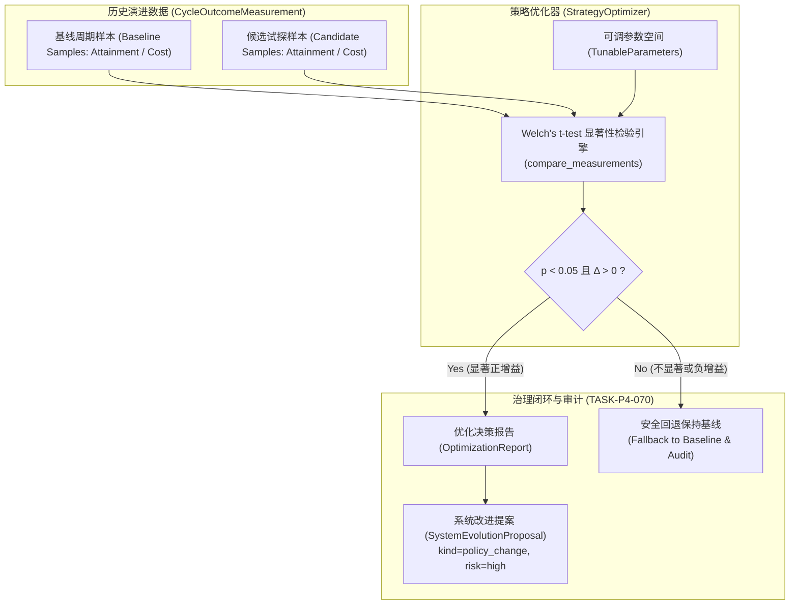

# 自主演进策略优化与参数调优架构设计（TASK-P4-050）

设计依据：
- `docs/tasks.md` `TASK-P4-050`（交付物：自主演进策略优化 —— 决策策略的自学习与参数调优；验收条件：“调优后达成度或单位成本收益相对基线有统计显著改善”；验证 T2）；
- `docs/design.md` §3.3 演进价值评估、§7 治理审批门；
- `R-033`（价值模型须用实际收益校准）；
- `R-121`（策略调整必须有据可依并在无收益时拒绝/退回）；
- `TASK-P4-070`（策略参数变更走 `SystemEvolutionProposal` 独立测试与审批发布）。

---

## 一、 核心设计思想

自主演进策略不是静态定死的硬编码规则，而是一套随项目演进历史进行**自学习、参数调优与统计显著性检验**的动态优化机制。

### 1.1 核心不变量

1. **参数必须有界有型（Bounded Tunability）**：
   - 调度容差 $tolerance \in [0.01, 0.25]$；
   - 探索频率 $explore\_every \in [1, 50]$（0 为不探索）；
   - 置信度门槛 $min\_confidence\_gate \in [0.10, 0.90]$；
   - 因子指数向量 $V, I, C, U, E$ 围绕历史样本均值进行幂变换。
   超出安全边界时，系统拒绝构造，杜绝参数无序漂移。

2. **实证与统计显著性假设检验（Welch's t-test）**：
   - 对比基线样本集（Baseline History）与调优候选样本集（Candidate History）；
   - 必须满足最少样本量约束（$N \ge 6$）；
   - 双侧检验要求 $p < 0.05$ 且效果量增益 $\Delta > 0$，方可判定为统计显著正向收益。

3. **不采纳也是合法决策（Fallback on Insignificance）**：
   - 未达到显著性阈值或收益为负时，系统安全回退并保持基线，输出审计说明。

4. **治理外置与提案联动（SystemEvolutionProposal Integration）**：
   - 采纳的策略变更自动触发 `TASK-P4-070` 规范，生成种类为 `policy_change` 的受控治理提案，绑定内容哈希摘要 `content_digest`、判定标准版本及架构治理评审资格 `governance`。

---

## 二、 架构组件交互全景

---

## 三、 验证矩阵与实测指标

| 检验场景 | 样本分布与均值 | 检验统计量与 p 值 | 决策结果 | 治理动作 |
| :--- | :--- | :--- | :--- | :--- |
| **显著正增益** | 基线 0.2083 vs 候选 0.6083 ($\Delta=+0.4000$) | $t=48.9898, p < 0.000001$ | `accepted = True` | 生成 `SystemEvolutionProposal` 提案等待架构师审批 |
| **微弱/不显著增益** | 基线 0.5083 vs 候选 0.5050 ($\Delta=-0.0033$) | $t=-0.3801, p=0.7121$ | `accepted = False` | 执行安全回退，禁止生成提案，保持基线参数 |
| **样本量不足** | 基线 2 条 vs 候选 1 条 ($< 3$) | $p=1.0$ | `accepted = False` | 拒绝推断，避免小样本伪显著 |

