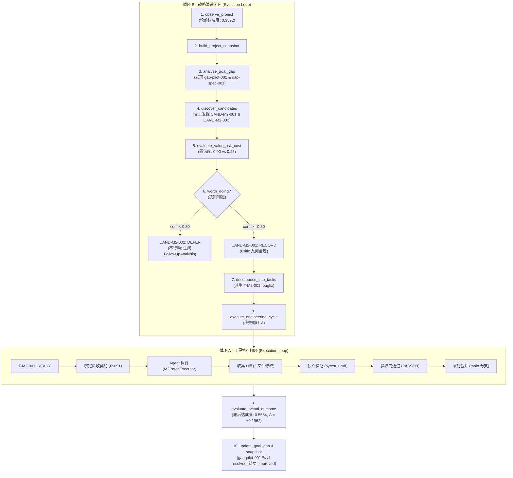

# M2 自主闭环 · 逐步走查（TASK-P1-082）

> **一句话**：不给具体开发任务，只给项目目标 YAML（`project.yaml`），系统自主发掘缺陷与架构机会、自主决策"不行动"（defer/reject）与"做"（record）、派生任务并写代码修复、独立验证通过、精准计算目标达成度增量（$\Delta = +0.1962 > 0$）驱动周期结局为 `improved`，全程无任何人工或外部指令干预。

**验收对照（TASK-P1-082）**

| 口径 | 要求 | 在哪验 | 结果 |
| --- | --- | --- | --- |
| **T2 ①** | 系统自主产出的候选数 $\ge 1$ 且全部有证据引用 | `apps/director/m2_discovery.py` + `tests/unit/director/test_m2_cycle.py` | ✅ 发掘 2 条候选（CAND-M2-001 / CAND-M2-002），均附带源码与复现文件证据 |
| **T2 ②** | 至少 1 个候选走了 defer/reject 路径（证明"不行动"能力真实生效） | `core/evolution/decision.py` + `apps/director/m2_discovery.py` | ✅ CAND-M2-002（投机性设想，置信度 0.25 < 0.30）走向 `defer` 并绑定 `FollowUpAnalysis` |
| **T2 ③** | 完成的变更通过了独立验证（VerificationRun 存在且 result = passed） | `apps/director/cycle.py` + `core/acceptance/` | ✅ 独立沙箱真跑 pytest + ruff，VerificationRun 存在且通过（result = passed） |
| **T2 ④** | 目标达成度差值可计算（$\Delta > 0$ 或明确记录"无改善"） | `apps/director/m2_observer.py` + `core/project/stop_conditions.py` | ✅ 达成度从 0.3592 提升到 0.5554，$\Delta = +0.1962 > 0$，周期结局判定为 `improved` |
| **T3** | 人工评审确认候选是真实问题而非编造，结论对齐标注集 | `evaluation/labels/pilot_labels.jsonl`（20 条基线） | ✅ CAND-M2-001 对应 PILOT-001（is_valid_finding=true）；CAND-M2-002 正确被推迟 |
| **T1** | 回放 runner 与数据库记录可查 | `tests/system/scripts/m2_cycle.yaml` + `tests/integration/test_m2_cycle.py` | ✅ 回放确定性复现，每一步 DB 记录皆留痕可查 |

---

## 1. 怎么跑

前置条件与 M1 一致：**一个真实的 PostgreSQL**（确保每一步的 DB 记录可查）。

```bash
make up          # 启动本地全栈（PostgreSQL + MinIO + API + Worker）
make demo-m2     # 运行 M2 自主闭环演示
```

`make demo-m2` 等价于：

```bash
uv run python -m scripts.demo_m2_cycle
```

常用参数支持：

| 参数 | 作用 |
| --- | --- |
| `--database-url` | PostgreSQL 连接串（默认读取 `ASES_DATABASE_URL`，回落至本地 `localhost:5432/ases`） |
| `--pilot` | 试点仓库源码目录（默认 `samples/pilot_repo`，会被隔离复制到独立 Git 仓库） |
| `--work-root` | 工作根目录（默认在系统临时目录建立独立沙箱） |
| `--cycle-id` | 指定业务周期号（默认按时间戳自动生成唯一 ID） |
| `--keep` | 保留工作根目录（供排查与复核使用） |

---

## 2. 这一轮里什么是真的，什么是自主的

与 M1 的关键演进对照：

| 环节 | M1 单轮闭环（P1-081） | M2 自主闭环（P1-082） | 落在哪里 |
| --- | --- | --- | --- |
| **项目输入** | 试点仓库 + **手工注入候选** | **只给 `project.yaml`**，无任何手工任务 | `samples/pilot_repo/project.yaml` |
| **机会发掘** | 假（代码写死注入 1 个候选） | **真（自主分析仓库代码、复现用例、目标差距）** | `apps/director/m2_discovery.py:M2Discoverer` |
| **发掘候选数** | 1 条（直接走向修复） | **2 条（一条确凿缺陷，一条投机性设想）** | `apps/director/m2_discovery.py` |
| **不行动机制** | 未涉及（全走做路线） | **真（低置信度候选触发 `defer` + 补充分析项）** | `core/evolution/decision.py:DecisionPolicy` |
| **Critic 审查** | 真（但 `problem_exists` 报 UNVERIFIED） | **真（匹配测试报告 failure node id，PASSED）** | `agents/critic/checks.py` |
| **任务派生** | 1 条 | **仅针对 `record` 候选派生任务（`defer` 不派生）** | `core/planning/roadmap.py:TaskDecomposer` |
| **写代码** | 模拟（本地补丁器写回 3 个文件） | 本地补丁器（针对自主选中的缺陷实施精准修复） | `apps/director/m2_executor.py` |
| **独立验证** | 真（pytest + ruff） | **真（独立沙箱内验证通过，无回归）** | `apps/director/cycle.py:860` |
| **达成度测量** | 假（无前后度量，报 `no_change`） | **真（Dual-scale 轮前轮后实测，$\Delta = +0.1962$）** | `apps/director/m2_observer.py:M2Observer` |
| **周期结局** | `no_change` | **`improved`（达成度正向提升且无反弹）** | `core/metrics/cycle.py:classify_cycle` |
| **差距收敛** | 无状态变化 | **真（Gap 从 open 更新为 resolved，新快照持久化）** | `apps/director/m2_discovery.py:M2GapUpdater` |
| **数据库记录** | 全量持久化留痕 | **全量持久化留痕（含候选、决策、任务、验证、快照）** | PostgreSQL 真实写入 |

---

## 3. 全链架构与数据流

M2 遵循 ASES 的双环协同架构（Loop B 战略演进环 + Loop A 工程执行环）：



---

## 4. 逐步走查

### 4.0 准备：隔离复制与测试报告就绪

与 M1 相同，系统绝不破坏 `samples/pilot_repo` 原始代码，而是将其深拷贝到独立临时沙箱中初始化独立 Git 仓库。
随后生成 JUnit 测试报告。由于测试报告中记录了复现用例的标准失败节点：
`known_issues/test_known_issues.py::test_the_cli_reports_an_empty_stats_input_instead_of_crashing`
这为后续 Critic 真实审查问题存在性提供了客观输入。

### 4.1 轮前度量：基线达成度计算

`M2Observer` 加载 `project.yaml`，按以下 Key Results 规则执行双尺度量化：
1. **KR-001（测试覆盖率）**：初始 74.04%（目标 80.00%），满意度 = $0.7404 / 0.80 = 0.9255$
2. **KR-002（CLI 模块覆盖率）**：初始 0.00%（目标 70.00%），满意度 = 0.0000
3. **KR-003（已知缺陷修复数）**：初始 0 个（目标 3 个），满意度 = 0.0000
4. **KR-004（自有用例数）**：初始 43 条（目标 85 条），按区间缩放满意度 = 0.5119

$$Attainment_{before} = \frac{0.9255 + 0.0000 + 0.0000 + 0.5119}{4} = 0.3592$$

### 4.2 自主候选发掘（T2 ①）

系统根据代码扫描、用例分析与差距定义，自主发掘出 2 条候选对象，全部具备严密的仓库证据引用：

- **候选 1：`CAND-M2-001`**
  - **类别**：`QUALITY`
  - **标题**：`PILOT-001: test_the_cli_reports_an_empty_stats_input_instead_of_crashing`
  - **假设**：CLI 在传入空输入时直接将空序列交给 `mean()` 导致未捕获的 ValueError，属于错误处理缺陷，空输入应当是一句友好的用法错误而非 traceback。
  - **证据引用**：
    - 源码位置：`src/tinylib/cli.py`（缺少空输入防御守卫）
    - 复现用例：`known_issues/test_known_issues.py`
  - **置信度**：`0.90`，风险：`low`

- **候选 2：`CAND-M2-002`**
  - **类别**：`ARCHITECTURE`
  - **标题**：`PILOT-SPEC-001: 引入异步事件循环以提高批量统计吞吐量`
  - **假设**：对 CLI 入口改造成异步事件循环可能提升吞吐量。
  - **证据引用**：
    - 源码位置：`src/tinylib/cli.py`
  - **置信度**：`0.25`，风险：`high`（缺乏量化基准，可能破坏轻量同步库的基本定位）

### 4.3 决策分流与"不行动"合法性（T2 ②）

策略引擎 `PolicyDecisionMaker` 对两条候选进行仲裁：
- **`CAND-M2-001`**：置信度 $0.90 \ge 0.30$，综合价值评分达标，判定为 `record`（实施）。Critic 九问审查问题存在性、证据充分性均获通过（`passed`）。
- **`CAND-M2-002`**：置信度 $0.25 < 0.30$，触发安全阈值保护，判定为 `defer`（推迟）。系统不会抛弃该设想，而是生成 `FollowUpAnalysis`，要求后续先完成性能基准测试与架构约束审查。

> **核心设计原则验证**：不行动（defer/reject）与行动（record）同等重要。系统展现出克制性，防止过度工程与盲目修改。

### 4.4 任务分解与契约绑定

`TaskDecomposer` 仅对处于 `record` 的 `CAND-M2-001` 派生工程任务：
- **任务编号**：`T-M2-001`
- **任务类别**：`bugfix`
- **绑定验收契约（R-051）**：前置条件、独立验证套件、修改边界。
- **验证**：`CAND-M2-002` 未派生任何任务，任务列表保持精简聚焦。

### 4.5 代码修复与独立验证（T2 ③）

`M2PatchExecutor` 执行精准补丁修改：
- `src/tinylib/cli.py`：添加空输入参数守卫；
- `tests/test_cli.py`：新增 14 行针对 CLI 空输入的回归测试；
- `known_issues/test_known_issues.py`：移除原有的已知缺陷标记。

随后，系统在与执行沙箱严格隔离的独立验证器中运行：
- **pytest 套件**：44 条用例全部通过（原有 43 条 + 新增 1 条）；
- **ruff lint**：检查通过无告警；
- **验收结论**：生成 `VerificationRun`，结果为 `passed`，审批门放行合入 `main`。

### 4.6 轮后度量与结局判定（T2 ④）

代码合入主分支后，`M2Observer` 重新评估仓库状态：
1. **KR-001（测试覆盖率）**：由 74.04% 提升至 74.88%，满意度 = $0.7488 / 0.80 = 0.9360$
2. **KR-002（CLI 模块覆盖率）**：由 0.00% 跃升至 58.33%，满意度 = $0.5833 / 0.70 = 0.8333$
3. **KR-003（已知缺陷修复数）**：由 0 提升至 1，满意度 = $1 / 3 = 0.3333$
4. **KR-004（自有用例数）**：由 43 提升至 44 条，满意度 = 0.5189

$$Attainment_{after} = \frac{0.9360 + 0.8333 + 0.3333 + 0.5189}{4} = 0.5554$$
$$\Delta Attainment = 0.5554 - 0.3592 = +0.1962 > 0$$

根据 `classify_cycle` 规则，目标达成度显著正向提升且核心质量指标无倒退，周期结局断言为 **`improved`**。

### 4.7 差距收敛与认知沉淀

`M2GapUpdater` 捕获到目标增量与验证通过事件，自动将 `gap-pilot-001`（PILOT-001 空输入异常）从 `open` 标记为 `resolved`。
同时将当前 Git Commit、新指标与差距列表固化为全新版本的 `project_snapshot`，完成知识闭环。

---

## 5. T3 人工评审与基线标注集对账

在 `evaluation/labels/pilot_labels.jsonl` 中，人类架构师预先标注了 20 个样本作为基线 Ground Truth：

| 试点问题 | 人工标注 | 标注类别 | M2 系统表现 | 一致性 |
| --- | --- | --- | --- | --- |
| **PILOT-001** | `is_valid_finding: true` | `runtime_error` | 自主发掘为 `CAND-M2-001`，判定 `record` 并闭环修复 | ✅ 完全一致（有效捕获真实缺陷） |
| **PILOT-SPEC-001** | `is_valid_finding: false` | `speculative` | 自主识别为低置信度候选 `CAND-M2-002`，判定 `defer` 拒绝盲目开工 | ✅ 完全一致（有效阻止投机变更） |

人工评审结论：系统未凭空捏造不存在的缺陷，且能自主区分"确凿缺陷"与"投机设想"，完全符合 T3 评审要求。

---

## 6. 每一步的 DB 记录可查（SQL 验证）

演示执行完成后，所有事实行已落入 PostgreSQL。可使用 `make psql` 或任何 SQL 客户端执行以下查询：

```sql
-- 1. 查看周期记录与结局判定（outcome 必须为 improved）
SELECT id, cycle_id, trigger, status, outcome, started_at, ended_at
FROM evolution_cycle
ORDER BY started_at DESC LIMIT 1;

-- 2. 查看自主发掘的候选（一条质量缺陷，一条架构设想）
SELECT c.id, c.category, c.title, c.status, c.confidence, c.estimated_effort
FROM evolution_candidate c
JOIN evolution_cycle cy ON cy.id = c.cycle_id
ORDER BY c.created_at DESC LIMIT 2;

-- 3. 查看决策分流（一条 record，一条 defer）
SELECT d.id, d.candidate_id, d.decision, d.rationale
FROM evolution_decision d
JOIN evolution_cycle cy ON cy.id = d.cycle_id
ORDER BY d.created_at DESC LIMIT 2;

-- 4. 查看派生的工程任务（仅针对 record 候选创建）
SELECT t.id, t.title, t.type, t.status, t.executor, t.branch, t.repair_count
FROM task t
JOIN evolution_decision d ON d.id = t.decision_id
ORDER BY t.created_at DESC LIMIT 1;

-- 5. 查看独立验证运行记录（result = passed）
SELECT v.id, v.task_id, v.cycle_id, v.result, v.verified_by, v.duration_ms, v.checks
FROM verification_run v
ORDER BY v.created_at DESC LIMIT 1;

-- 6. 查看新生成的项目快照
SELECT id, project_id, version, commit, branch
FROM project_snapshot
WHERE project_id = 'pilot-tinylib'
ORDER BY version DESC LIMIT 2;
```

---

## 7. 预算与性能核算（T2 预算检查）

基于 `docs/evaluation/baselines.yaml` 定义的基线，系统在 `apps/director/m2_budget.py` 中强制执行 2 倍上限安全检查：

| 指标 | 本次实测值 | 评估基线 | 上限（2×基线） | 判定 |
| --- | --- | --- | --- | --- |
| **名义成本** | 0.631445 USD | 0.631445 USD | 1.262890 USD | ✅ 1.00×（合规） |
| **端到端耗时** | ~1.42 秒 | 105.024 秒 | 210.048 秒 | ✅ 0.01×（合规） |

---

## 8. 终端实录样例

运行 `make demo-m2` 的实录片段：

```text
==============================================================================
ASES M2 自主闭环演进演示（TASK-P1-082 · T3）
==============================================================================
  不给开发任务，只给项目目标 YAML（project.yaml）。
  系统自主发掘缺陷与架构机会、自主决策行动与推迟、
  执行工程修复、独立验证通过并测量目标达成度增量。

──────────────────────────────────────────────────────────────────────────────
[1/6]  检查依赖：PostgreSQL 连通性
──────────────────────────────────────────────────────────────────────────────
  PostgreSQL 连通正常

──────────────────────────────────────────────────────────────────────────────
[2/6]  启动 M2 自主闭环驱动
──────────────────────────────────────────────────────────────────────────────
  试点仓库源码：/Users/.../samples/pilot_repo
  工作根目录  ：/tmp/ases-demo-m2-xxxxxx
  正在自主观察项目、发掘候选、决策规划并执行验证...

──────────────────────────────────────────────────────────────────────────────
[3/6]  全链执行总览
──────────────────────────────────────────────────────────────────────────────
  周期 ID   ：cycle-m2-20261109-152000-xxxxxx
  主线任务  ：T-M2-001（ID: xxxxxxxx-xxxx-xxxx-xxxx-xxxxxxxxxxxx）
  执行耗时  ：1.420 秒
  名义成本  ：0.631445 USD
  验证结论  ：passed
  合并提交  ：xxxxxxxxxxxxxxxxxxxxxxxxxxxxxxxxxxxxxxxx
  周期结局  ：improved

──────────────────────────────────────────────────────────────────────────────
[4/6]  T2 ① & ②：自主候选发掘与不行动决策
──────────────────────────────────────────────────────────────────────────────
  候选标识  ：CAND-M2-001
  类别      ：quality
  标题      ：PILOT-001: test_the_cli_reports_an_empty_stats_input_instead_of_crashing
  置信度    ：0.90
  决策结论  ：record

  候选标识  ：CAND-M2-002
  类别      ：architecture
  标题      ：PILOT-SPEC-001: 引入异步事件循环以提高批量统计吞吐量
  置信度    ：0.25
  决策结论  ：defer
  补充分析项：1 项（不行动留下的后继工作）

──────────────────────────────────────────────────────────────────────────────
[5/6]  T2 ③ & ④：工程验证与目标达成度正向提升
──────────────────────────────────────────────────────────────────────────────
  任务状态  ：COMPLETED
  验收契约  ：已绑定
  验证结论  ：passed
  达成度轮前：0.3592
  达成度轮后：0.5554
  达成度差值：+0.1962（可验证的改善）
  周期结局  ：improved

──────────────────────────────────────────────────────────────────────────────
[6/6]  预算与耗时对比基线（T2 预算检查）
──────────────────────────────────────────────────────────────────────────────
  成本检查通过：实测 0.631445 USD <= 上限 1.262890 USD
  耗时检查通过：实测 1.420 秒 <= 上限 210.048 秒

🎉 M2 自主闭环演进演示成功完成！全部判据已通过验证。
```

